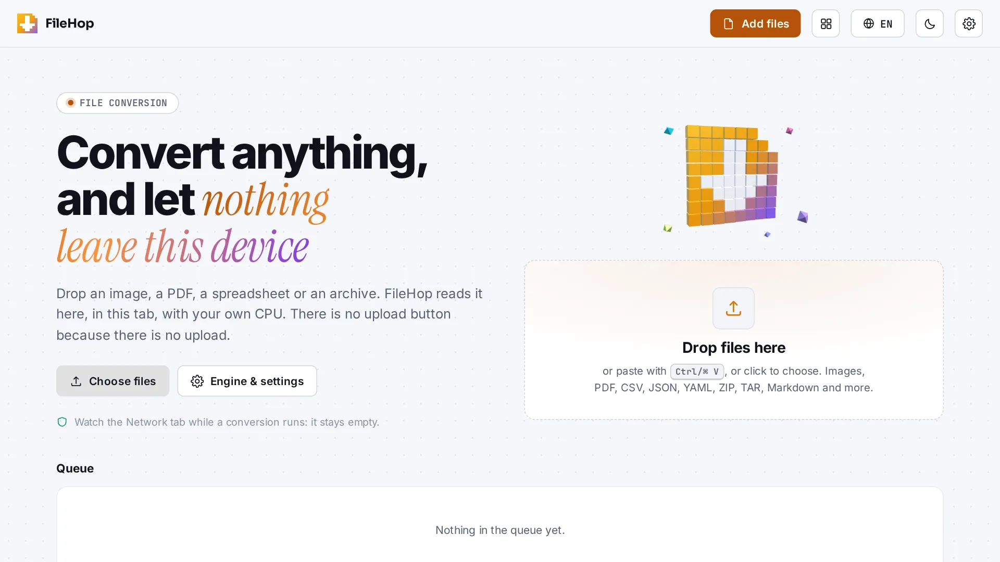

<p align="center">🌐 <b>English</b> · <a href="README.zh-CN.md">简体中文</a> · <a href="README.de.md">Deutsch</a> · <a href="README.id.md">Bahasa Indonesia</a> · <a href="README.ja.md">日本語</a> · <a href="README.pt-BR.md">Português (Brasil)</a> · <a href="README.es.md">Español</a> · <a href="README.fr.md">Français</a> · <a href="README.ru.md">Русский</a></p>

<p align="center"><picture><source media="(prefers-color-scheme: dark)" srcset="docs/readme/hero-dark.webp"></picture></p>

<p align="center"><b>Any file, any format, on your device.</b><br>FileHop converts images, PDFs, tables, text and archives in your browser. Nothing is uploaded, with one optional exception you start yourself (see below).</p>

<p align="center">
  <a href="https://file.hel.ink"><b>Try it online</b></a> ·
  <a href="#run-your-own">Run your own</a> ·
  <a href="#what-it-converts">What it converts</a> ·
  <a href="#faq">FAQ</a> ·
  <a href="docs/DEPLOY.md">Deploying</a> ·
  <a href="docs/TESTING.md">Testing</a> ·
  <a href="CHANGELOG.md">Changelog</a>
</p>

<p align="center"><sub>One Go binary · conversion runs in the browser tab · 9 languages · no ads, no trackers · free and open source (MIT)</sub></p>

> [!IMPORTANT]
> FileHop has no upload button because there is no upload. Files are opened with the browser's File API, converted inside the tab with your own CPU, and handed back as a download. The server sends the app and, if you sign in, keeps your HOP ID session. It never receives a file, with one exception: if the owner has switched on "Save to PixelHop" and you are signed in, a button on a finished image or PDF sends that one result through the server to your PixelHop library after you confirm it (the page says so right there). FileHop does not keep it.

FileHop is a file converter you can run yourself. Drop files on the page, pick a format on each card (or one for the whole group), press Convert, download. It is for people who:

- need a PNG as WebP, a scan as PDF, or a PDF split into pages, and do not want to hand the file to a website,
- turn CSV into JSON or YAML (and back) without a spreadsheet,
- want to see what is inside a ZIP, or check a file's SHA-256, on a machine where they cannot install software.

Install it with one command. The script checks your computer, asks a few questions, and can connect FileHop to a HOP ID account hub:

```bash
curl -fsSL https://raw.githubusercontent.com/navi-crwn/FileHop/main/install.sh | bash
```

From a clone: `./install.sh`. Update with `./update.sh` and remove with `./uninstall.sh`. Add `--yes` to accept every default; `--help` lists the options.

## What it converts

| Category | In | Out |
|---|---|---|
| Images | PNG, JPEG, WebP, AVIF\*, GIF, BMP, TIFF, ICO, SVG | WebP, AVIF\*, JPEG, PNG, PDF |
| PDF | PDF | merged, split (ZIP), rotated, page selection, pages → PNG/JPEG (ZIP), document info (JSON) |
| Data | CSV, TSV, JSON, YAML | CSV, TSV, JSON, YAML |
| Text | Markdown, HTML, plain text | HTML, Markdown, plain text |
| Archives | ZIP, TAR, GZIP | ZIP (repacked), GZIP, listing (JSON) |
| Anything | any file | SHA-256, BLAKE3, MD5 |

\* AVIF output is offered only where the browser's own encoder can write it. Canvas silently returns a PNG when it cannot, so FileHop checks the result and hides the target instead of handing you a mislabelled file.

**Not here yet:** DOCX and LaTeX (needs pandoc, GPL), RAR and 7z, video and audio. The app says so in its formats section rather than pretending.

Tested on 2026-11-08 in Chromium 158, Firefox 159 and the WebKit engine (22 conversions each, all passed). Safari on a Mac or iPhone has not been tested yet. Details: [docs/TESTING.md](docs/TESTING.md).

## What the server sees

- The app's own files (HTML, scripts, fonts). Every request is same-origin; the page loads nothing from any other site.
- If you sign in with HOP ID: your HOP ID number, name and email, and a session cookie. Signing out, or being signed out by the hub, deletes the session.
- Never a file, a file name, or a conversion result, except the one you send yourself with "Save to PixelHop" (only when it is switched on and you are signed in): that file is held in memory for the length of the call, signed as you, forwarded to PixelHop and forgotten; it is never written to disk or logged by FileHop. (PixelHop's request line carries the file name, because the name is part of the signed path; FileHop's own request carries it in a header, not in the address.)
- On `/send` (a file straight from one device to another): a short-lived six-digit room code, the two devices' session descriptions for a few seconds while they connect, and their IP addresses. After that the devices talk directly and the server is out of the path; the file, its name and its size never reach it. The file travels encrypted between the two browsers, and FileHop does not scan it.

The page runs cross-origin isolated (`Cross-Origin-Embedder-Policy: require-corp`) with a strict Content Security Policy: no inline scripts, no `eval`, no third-party hosts.

## Run your own

**With the installer** (above): it builds the browser app with Node 20.19+ and the server with Go 1.27+, or uses Docker, and writes `.env`, `start.sh` and a systemd unit for you.

**By hand:**

```bash
npm ci && npm run build        # the browser app → web/dist
go build -o filehop ./cmd/filehop
FILEHOP_ADDR=127.0.0.1:8095 ./filehop
```

Settings are environment variables, listed in [`deploy/filehop.env.example`](deploy/filehop.env.example). Without `FILEHOP_SSO_URL` FileHop runs with no accounts at all, which is a complete converter. With it, people can sign in with HOP ID from your hub (HEL.ink). [docs/DEPLOY.md](docs/DEPLOY.md) covers nginx, systemd and the hub.

**For development:**

```bash
npm run dev          # http://localhost:5179, the browser app alone (Vite)
npm run local        # http://localhost:8095, the Go server + a stand-in hub on :8097
```

`npm run local` runs the real server next to `tools/hubstub`, a small stand-in for the HOP ID hub and the Imperium control panel with the same wire formats, so sign-in, sign-out and account events can be tried on one machine.

## FAQ

**Is my file sent anywhere?** No. Open the Network tab in your browser's developer tools while a conversion runs: it stays empty.

**Do I need an account?** No. Everything works without one. A HOP ID only adds the account menu today; synced presets come later.

**How big can a file be?** As big as your browser's memory allows. FileHop estimates the memory a job needs before it starts and tells you when a file is too large for this device. Batches are capped at 50 files.

**Why is AVIF missing on my computer?** Your browser cannot write AVIF. FileHop only offers formats it can actually produce.

**Are the conversions safe for untrusted files?** FileHop treats every file as hostile: archives are measured before they are unpacked (zip bombs and `../` paths are refused), SVG is drawn through an image element that never runs scripts, and PDFs are read with pdf.js, which does not run a document's JavaScript.

## Under the hood

```
web/src/App.svelte (queue UI)
   └── Queue (web/src/lib/store/queue.svelte.ts)   $state array of $state jobs
         └── Pool (web/src/lib/core/pool.ts)       one Worker per slot, sized by the machine
               └── convert.worker.ts              runJob() → engines
                     ├── run/image.ts              canvas + createImageBitmap + pdf-lib
                     ├── run/pdf.ts                pdf.js (read) + pdf-lib (write)
                     ├── run/data.ts               papaparse / yaml, one table model
                     ├── run/text.ts               marked, and a DOM-free HTML → Markdown rule set
                     ├── run/archive.ts            fflate + a ustar reader
                     └── run/hash.ts               hash-wasm, 8 MB chunks

cmd/filehop          the server: web/dist embedded, headers, HOP ID sign-in, /hop/*
internal/app         routes, sign-in, the HOP App Protocol handlers
internal/db          SQLite: accounts, sessions, handled event ids (no files)
internal/hop         HOP App Protocol v1, the same as NoteHop's
```

- **Type comes from the bytes.** Magic bytes first, the extension second. A JPEG renamed `.txt` still opens, and the card says "Name ≠ content".
- **One job, one worker.** The pool leaves a core for the page, drops to 2 workers on phones and low-memory devices, and can be pinned to 1 in the settings.
- **Canvas work moves to the page when it must.** SVG needs an ``, and browsers without `OffscreenCanvas` (Safari before 16.4) cannot draw in a worker, so those jobs take one main-thread slot.
- **Nothing is fetched at run time.** The whole engine is in the bundle (about 236 KB gzip for the worker chunk, 45 KB for the page).
- **`/send` is peer to peer.** WebRTC data channel, one ordered reliable channel, 16 KB messages with two layers of backpressure, SHA-256 checked before a file is offered for saving, and a six-digit number both people compare (committed to before the handshake, so the signalling server cannot pick a certificate after seeing the real one). Optional environment: `FILEHOP_TRUST_PROXY=1` behind nginx, `FILEHOP_STUN_URLS` for STUN. No TURN: a pair that cannot connect is told so.
- **For the family:** `/hop/health`, `/hop/manifest`, `/hop/stats`, `/hop/users/{sub}` and `/hop/events` answer signed calls from the Imperium control panel and the hub.

Type: Inter for text, Instrument Serif italic for the accent phrase, JetBrains Mono for file names and hashes, all vendored in `web/public/hop-fonts/` (byte-identical to the family set in `hel.ink/hop-assets/v3`, kept local so the page loads nothing from another site). Languages: `en, zh-CN, de, id, ja, pt-BR, es, fr, ru` in `web/src/lib/i18n/`; `npm run lint:i18n` keeps them in step.

## Security, license and history

Report vulnerabilities privately: [SECURITY.md](SECURITY.md). FileHop is MIT-licensed ([LICENSE](LICENSE)). Its libraries: `pdfjs-dist` Apache-2.0 · `pdf-lib` MIT · `fflate` MIT · `hash-wasm` MIT · `marked` MIT · `papaparse` MIT · `yaml` ISC · Svelte MIT · fonts SIL OFL 1.1. No GPL or AGPL engine is included. What changed and when: [CHANGELOG.md](CHANGELOG.md).

## Self-hosting

<!-- self-hosting:start -->
Everything FileHop needs is in public repositories: no private repository, no token and no hel.ink account. The family guide has the details: [docs/self-hosting.md](https://github.com/navi-crwn/HEL.ink/blob/main/docs/self-hosting.md).

| Piece | For FileHop | What it does |
| --- | --- | --- |
| [HEL.ink](https://github.com/navi-crwn/HEL.ink) (hub, HOP ID) | Optional: adds “Sign in with HOP ID” | Accounts and sign-in for every app |
| [Imperium](https://github.com/navi-crwn/Imperium) | Optional | Admin panel for the whole family; needs the hub |
| Family fonts and tiles | Nothing to install: loaded from `hel.ink/hop-assets` | Without hel.ink: system fonts, no floating tiles |

- **Install order**: FileHop alone with `./install.sh`. For HOP ID sign-in, the [hub](https://github.com/navi-crwn/HEL.ink) first: `./install.sh --hub new` installs one next to it.
- **Minimum settings**: `FILEHOP_BASE_URL`; with the hub: `FILEHOP_SSO_URL`, `FILEHOP_SSO_CLIENT=filehop`, `FILEHOP_SSO_SECRET`.
- **Alone or in the family**: FileHop runs alone with no accounts at all, which is a complete converter. With a hub, people can sign in with HOP ID.
- **Without Imperium**: nothing is missing: FileHop stores no files, and Imperium only shows its health and numbers.
<!-- self-hosting:end -->

## The Hop family

FileHop is part of the HOP family of privacy-respecting, self-hostable open-source apps.

<!-- hop-family:start -->
<!-- Generated from HEL.ink resources/hop-assets/apps.source.json; edit there, then run scripts/hop_assets.py build. -->
| App | Address | Repository | What it does |
| --- | --- | --- | --- |
| **HOP ID** | [hel.ink](https://hel.ink) · accounts at `hub.hel.ink` | [navi-crwn/HEL.ink](https://github.com/navi-crwn/HEL.ink) | One account for every HOP app. |
| **LinkHop** | [link.hel.ink](https://link.hel.ink) · `hel.ink/l/…` | [navi-crwn/LinkHop](https://github.com/navi-crwn/LinkHop) | Short links, QR codes and click analytics. |
| **BioHop** | [bio.hel.ink](https://bio.hel.ink) · `hel.ink/b/…` | [navi-crwn/BioHop](https://github.com/navi-crwn/BioHop) | One link-in-bio page for everything you do. |
| **PixelHop** | [pixel.hel.ink](https://pixel.hel.ink) · `p.hel.ink/…` | [navi-crwn/PixelHop](https://github.com/navi-crwn/PixelHop) | Image hosting with albums and direct links. |
| **NoteHop** | [note.hel.ink](https://note.hel.ink) · `n.hel.ink/…` | [navi-crwn/NoteHop](https://github.com/navi-crwn/NoteHop) | Encrypted notes you share with a link. |
| **FileHop** | [file.hel.ink](https://file.hel.ink) | [navi-crwn/FileHop](https://github.com/navi-crwn/FileHop) | Convert files in your browser; nothing is uploaded. |
| **PayHop** | [pay.hel.ink](https://pay.hel.ink) | [navi-crwn/PayHop](https://github.com/navi-crwn/PayHop) | Make a payment QR and split a bill; nothing leaves your browser. |
| **Imperium** | not public-facing: optional, for admins | [navi-crwn/Imperium](https://github.com/navi-crwn/Imperium) | The HOP control panel. |
<!-- hop-family:end -->
